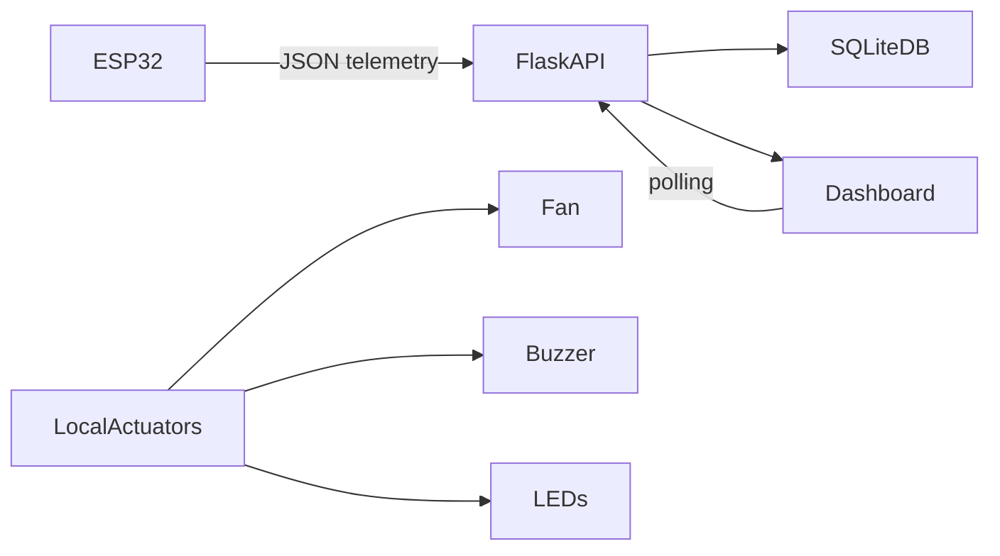

# Smart Refrigerator Monitoring System

A production-style IoT monitoring project for a smart refrigerator, built to support five sensor channels, three local actuators, and a Flask analytics dashboard. The design keeps local control operational without a network and sends telemetry to a central server over WiFi when available.

## Architecture overview

## Features

- ESP32 reads DS18B20 temperature, MQ-135 raw ADC, reed-switch state, TTP223 mute touch, and RC522 RFID scans
- Local temperature alarm above 29°C commands the fan, red/green LEDs, and buzzer; touch mutes the buzzer for 30 seconds
- RFID scans are stored as UID events; food names require an explicit UID-to-item mapping
- Flask API with authentication, validation, alert lifecycle, and retention logic
- SQLite-backed persistence with WAL mode and indexed timestamps
- Live dashboard in plain HTML/CSS/vanilla JS with Chart.js
- Scenario-based simulator for demoing without hardware
- Firmware and server configuration separated cleanly for real deployment

## Stack

- Firmware: Arduino C++ / PlatformIO for ESP32
- Backend: Flask, Pydantic, SQLite
- Frontend: HTML, CSS, JavaScript, Chart.js
- Tests: Pytest

## Setup

1. Open PowerShell in the repo root.
2. Create a Python environment:
   `py -3 -m venv .venv`
3. Activate it and install the backend dependencies:
   `.\.venv\Scripts\Activate.ps1`
   `python -m pip install -r .\server\requirements.txt`
4. Create the local server environment file and use a private key of your choice:
   `Copy-Item .\server\.env.example .\server\.env`
   Set `SMART_FRIDGE_API_KEY` in `.env`; this value must exactly match `API_KEY` in the firmware's untracked `device_config.h`.
5. Start the API and dashboard (the server binds to all network interfaces so the ESP32 can reach it):
   `python .\server\run.py`
6. On the same computer, open http://127.0.0.1:5000/. Check `http://127.0.0.1:5000/health` for server health.
7. For a no-hardware demo only, run `python .\server\simulator\run.py --scenario demo --interval 2`. Stop the simulator before testing physical sensor values so demo telemetry is not mistaken for device data.

## Firmware flash steps

The current firmware uses the DS18B20, MQ-135, reed switch (status unverified until the magnet is installed), TTP223, and RC522. Load cell and humidity are excluded. MQ-135 readings are raw ADC (0–4095), not calibrated ppm or a food-spoilage verdict.

1. Copy `firmware/src/device_config.example.h` to `firmware/src/device_config.h` and fill in the 2.4 GHz WiFi SSID/password, device ID, API key, and server URL. Use the same API key as `SMART_FRIDGE_API_KEY` in `server/.env`. This local secrets file is ignored by Git.
2. Keep the ESP32 and the computer running Flask on the same WiFi/hotspot. Find the computer's IPv4 address with `ipconfig` and use it in `API_ENDPOINT`, for example `http://192.168.1.23:5000/api/v1/readings`. Do not use `localhost` or `127.0.0.1` in the ESP32 URL: those addresses refer to the ESP32 itself. If using a phone hotspot, use the computer's hotspot-network IPv4 address; some hotspots block communication between clients.
3. Permit Python/port 5000 through the computer firewall on the active private network if the ESP32 cannot connect.
4. Open the project in VS Code with PlatformIO or use the CLI:
   `pio run -d firmware`
5. Upload with:
   `pio run -d firmware -t upload`
6. Open the PlatformIO serial monitor at 115200 baud. Confirm sensor readings and HTTP 201 responses. The dashboard updates from the API every two seconds; the sensor sends its telemetry every two seconds as well.

## Hardware-to-dashboard verification

1. Start Flask and verify `/health` in the computer browser.
2. Flash the firmware, open the serial monitor, and wait for WiFi to connect. Confirm successful HTTP responses in serial output.
3. Open the dashboard from the computer at `http://127.0.0.1:5000/`. Confirm temperature, raw gas ADC trend, sensor health, reported controller outputs, alarm/mute state, and RFID events. The first scan of a tag creates a count of one. In **RFID food inventory**, enter its food name (such as Tomato); later scans of that tag increase the count. You can edit the name or count there. Door status remains **SENSOR UNVERIFIED** and door alarms stay disabled until the magnet and switch polarity are verified.
4. To verify ingestion independently, use `GET http://127.0.0.1:5000/api/v1/readings/latest` in a browser or send an authenticated POST to `/api/v1/readings`. The endpoint accepts null/omitted temperature, gas, humidity, and weight; missing sensors are not represented as invented measurements.

## Calibration procedure

1. Power on the ESP32 and open serial output.
2. For DS18B20, confirm the reading is within a plausible range. A disconnected sensor is marked unavailable rather than replaced with a fabricated value.
3. Let the MQ-135 warm up according to its datasheet, observe raw ADC readings, and validate response to a safe, controlled test. Raw ADC is a relative trend, not ppm.
4. Confirm the reed switch reads closed with the magnet at the switch and open when separated; change the active level in firmware only if your module is wired differently.
5. Above 29°C, confirm fan, red LED, and buzzer commands turn on. A TTP223 touch should mute the buzzer for 30 seconds while the red LED and fan remain on. At 29°C or below, the alarm clears and the green LED is commanded on.
6. Scan a 13.56 MHz RFID card or key fob and check **Recent RFID scans**. A UID is only an identifier; no food name is inferred without a mapping.

## Demo script

1. Start the server:
   `python .\server\run.py`
2. Start the simulator in normal mode and verify the overview page.
3. Switch to `warm` to trigger a temperature warning.
4. Switch to `door` to trigger the door-open alert.
5. Switch to `gas` to trigger the gas-rise alert.
6. Switch to `lowstock` to trigger low inventory.
7. Switch to `demo` to cycle through all alert conditions automatically.
8. Open the Alerts page, acknowledge an alert, and confirm the state change.
9. Open Device & Settings to adjust thresholds or reset the gas baseline.

## Known limitations

- MQ-135 values are a relative indicator of gas trend, not calibrated absolute ppm.
- The refrigerator simulator replaces the physical hardware; real-world calibrations may vary by enclosure and sensor placement.
- The server uses SQLite and should be treated as a local/offline-friendly lab system rather than a large-scale industrial telemetry platform.
