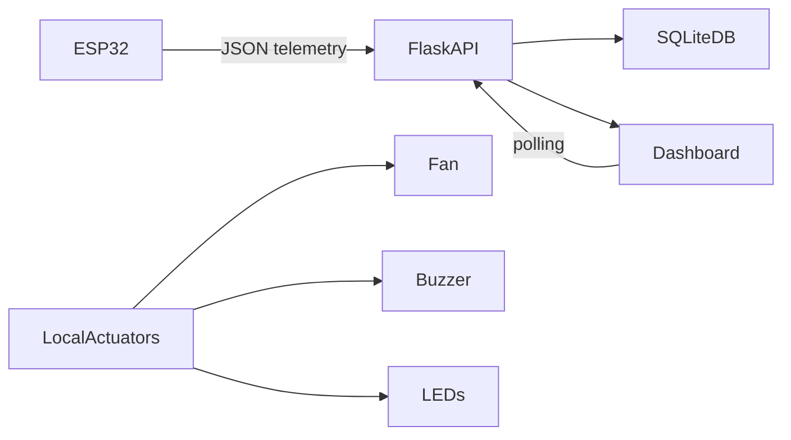

# Smart Refrigerator Monitoring System

A production-style IoT monitoring project for a smart refrigerator, built to support five sensor channels, three local actuators, and a Flask analytics dashboard. The design keeps local control operational without a network and sends telemetry to a central server over WiFi when available.

## Architecture overview

## Features

- ESP32 data acquisition for temperature, humidity, gas, door state, and inventory weight
- Local control for fan, buzzer, and LEDs using hysteresis and a finite state machine
- Flask API with authentication, validation, alert lifecycle, and retention logic
- SQLite-backed persistence with WAL mode and indexed timestamps
- Live dashboard in plain HTML/CSS/vanilla JS with Chart.js
- Scenario-based simulator for demoing without hardware
- Firmware and server configuration separated cleanly for real deployment

## Stack

- Firmware: Arduino C++ / PlatformIO for ESP32
- Backend: Flask, Pydantic, SQLite
- Frontend: HTML, CSS, JavaScript, Chart.js
- Tests: Pytest

## Setup

1. Open PowerShell in the repo root.
2. Create a Python environment:
   `py -3 -m venv .venv`
3. Activate it and install the backend dependencies:
   `.\.venv\Scripts\Activate.ps1`
   `python -m pip install -r .\server\requirements.txt`
4. Start the API locally:
   `python .\server\run.py`
5. Open the dashboard at http://localhost:5000/
6. Run the simulator: `python .\server\simulator\run.py --scenario demo --interval 2`

## Firmware flash steps

1. Copy `firmware/config.example.h` to a local config file and fill in your WiFi and API values.
2. Open the project in VS Code with PlatformIO or use the CLI:
   `pio run -d firmware`
3. Upload with:
   `pio run -d firmware -t upload`
4. Check the serial monitor to confirm telemetry is reaching the Flask API.

## Calibration procedure

1. Power on the ESP32 and open serial output.
2. Tare the HX711 load cell before placing food into the refrigerator.
3. Use the serial console to review the calibration values and update the zero offset if needed.
4. For DS18B20, confirm the reading is within a plausible range and inspect the fallback path if the sensor returns NaN.
5. Validate the MQ-135 value against a baseline with door closed and stable conditions; treat it as relative gas-rise tracking, not exact ppm.

## Demo script

1. Start the server:
   `python .\server\run.py`
2. Start the simulator in normal mode and verify the overview page.
3. Switch to `warm` to trigger a temperature warning.
4. Switch to `door` to trigger the door-open alert.
5. Switch to `gas` to trigger the gas-rise alert.
6. Switch to `lowstock` to trigger low inventory.
7. Switch to `demo` to cycle through all alert conditions automatically.
8. Open the Alerts page, acknowledge an alert, and confirm the state change.
9. Open Device & Settings to adjust thresholds or reset the gas baseline.

## Known limitations

- MQ-135 values are a relative indicator of gas trend, not calibrated absolute ppm.
- The refrigerator simulator replaces the physical hardware; real-world calibrations may vary by enclosure and sensor placement.
- The server uses SQLite and should be treated as a local/offline-friendly lab system rather than a large-scale industrial telemetry platform.
