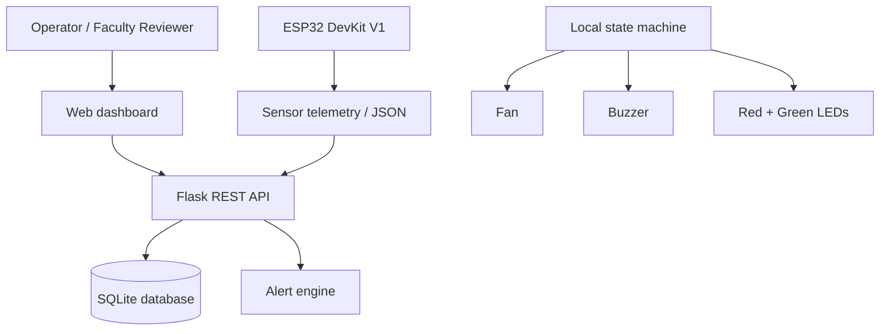
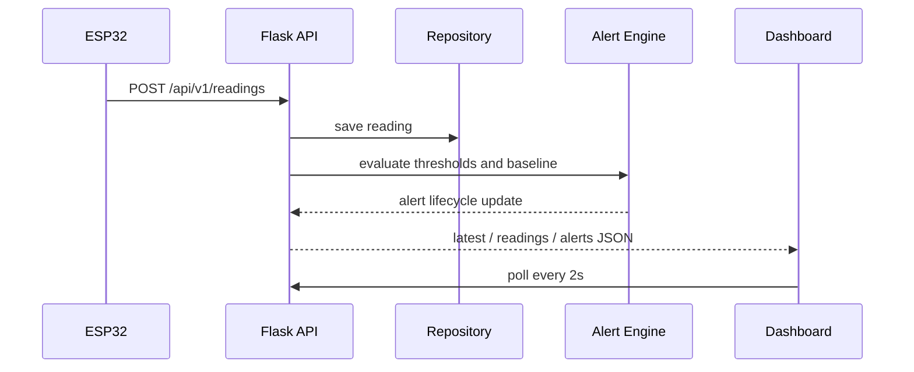
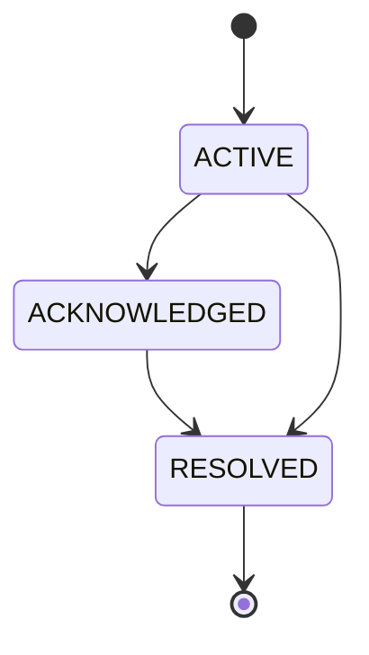
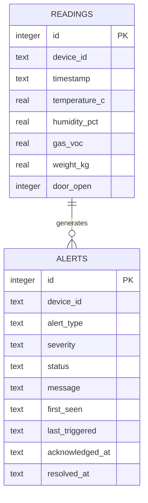

# Architecture

## System context

## Data flow

## Alert state machine

## Database schema

## Event model

The database is intentionally split into operational telemetry, alert state, and configuration values so the web dashboard can independently query summary analytics without mixing them with live sensor history.
